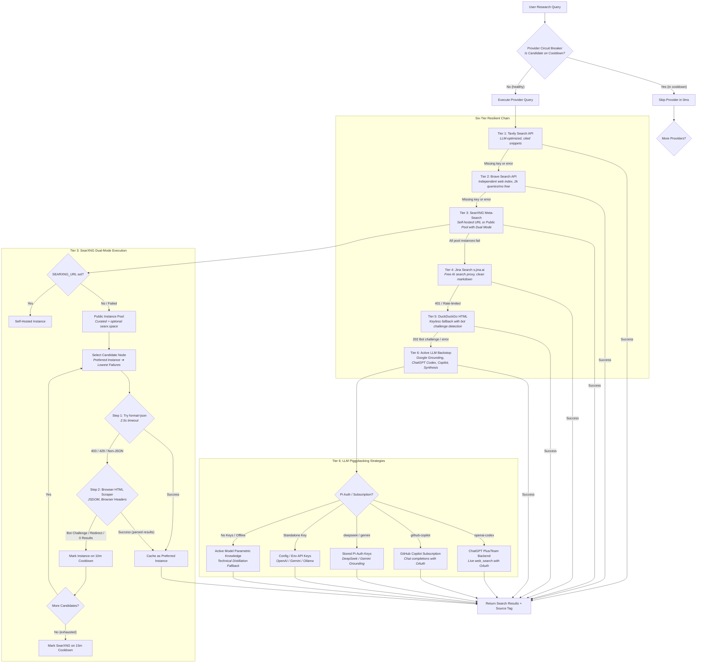

# pi.Research

[](https://opensource.org/licenses/MIT)
[](https://www.typescriptlang.org/)
[](https://nodejs.org/)

**A resilient, token-efficient web research subagent extension for Pi.**

`pi.Research` brings the process-isolation and context-economy architecture of `pi.Foreman` to the open web. It shields the parent coding agent's context window from raw HTML DOMs, SEO spam, cookie banners, and browsing tangents by spawning an isolated subagent that distills the web into concise, structured answers with citations.

---

## Key Features

- **Context Firewall**: Spawns an isolated child agent with an empty message array and a dedicated toolset (`search_web`, `read_page_markdown`, `search_cache`). Local mutation tools (`bash`, `write`, `edit`) are strictly omitted.
- **Resilient Six-Tier Search**: Never fails because of a single search engine's bot detection, rate limit, or outage. Seamlessly cascades across six tiers: **Tavily ➔ Brave ➔ SearXNG ➔ Jina ➔ DuckDuckGo ➔ Active LLM**.
- **Dual-Mode SearXNG Scraper (JSON ➔ HTML)**: Automatically attempts fast JSON API search. If an instance blocks automated JSON (`403 Forbidden` or `429 Too Many Requests`), it transparently switches to browser-styled HTML scraping via JSDOM on the same instance, bypassing API restrictions.
- **Dual-Level Circuit Breakers**:
  - **Instance-Level Pool Breaker**: 2.5s strict timeout, 10-minute cooldown, and session stickiness for individual SearXNG nodes.
  - **Provider-Level Circuit Breaker**: Bypasses persistently failed or bot-blocked search engines in **0ms** on subsequent queries within a 15-minute cooldown window, eliminating cascading network timeouts.
- **Dynamic `searx.space` Pool Discovery**: Optionally queries `https://searx.space/data/instances.json` in real time (with 1-hour in-memory caching) to discover and rotate through active, high-uptime public SearXNG nodes worldwide.
- **Zero-Config Pi Subscription Reuse**: Automatically discovers and reuses active OAuth tokens from your existing Pi login (`~/.pi/agent/auth.json`), enabling ChatGPT (`openai-codex`) live search or GitHub Copilot (`github-copilot`) technical synthesis without needing standalone API keys.
- **Readability & Observation Masking**: Uses Mozilla Readability + Turndown to strip scripts, styles, navbars, and boilerplate. Automatically strips image tags (``) and URL tracking tokens before text enters the LLM context.
- **Large Document Pagination Cache**: Documents exceeding the character budget are stored in an in-memory TTL-bounded cache, returning an excerpt and a `cache_id` so the agent can query specific passages via `search_cache`.
- **Strict Output Format Enforcement**: Validates that all research outputs strictly follow the structured `ANSWER` and `SOURCES` schema.

---

## Architecture & Search Flow

Consumer search engine HTML endpoints (like DuckDuckGo HTML) are inherently fragile in automated environments, frequently returning HTTP 202 bot challenges (`anomaly.js?cc=botnet`) or rate limits. Public meta-search engines often restrict JSON endpoints.

`pi.Research` eliminates this fragility with a **hierarchical cascading fallback chain** paired with **dual-level circuit breaking**:



---

## Resilience Mechanisms

### 1. Dual-Level Circuit Breakers

Search operations in automated pipelines often suffer from cascading latency: when one provider goes down or blocks the client IP, subsequent queries repeatedly re-attempt the dead provider, incurring 5–10 seconds of cumulative timeouts on every search. `pi.Research` resolves this at two distinct levels:

#### Level 1: Instance-Level Pool Circuit Breaker (SearXNG)

- **Strict 2.5-Second Budget**: Individual SearXNG nodes are capped at a 2.5s response timeout to prevent lagging instances from stalling research.
- **Cooldown & Failure Tracking**: If a node returns HTTP 403 (JSON disabled), 429 (rate-limited), timeouts, or empty HTML, its failure count increments and it enters an in-memory **10-minute cooldown**.
- **Session Stickiness**: When an instance succeeds, it is cached as the `preferredSearxngInstance` for the active session. Subsequent queries try the proven node first, yielding near-instant responses.

#### Level 2: Provider-Level Circuit Breaker

- **Session Health Tracking**: Tracks provider status across `tavily`, `brave`, `searxng`, `jina`, `duckduckgo`, and `llm`.
- **Zero-Latency Bypass (0ms)**: When an engine experiences a persistent block (e.g., DuckDuckGo 202 Bot Challenge, Jina 401 AS7018 IP block, or SearXNG pool exhaustion), it enters a **15-minute cooldown** (`providerCooldownMs`). On all subsequent queries within that window, the failed engine is bypassed in **0ms** without sending network traffic or waiting on timeouts.
- **Fail-Safe Retries**: If all candidate providers enter cooldown simultaneously, the circuit breaker automatically retries the oldest failed candidate to prevent an unnecessary hard failure.

```
Query 1: [Tavily (no key)] ➔ [Brave (no key)] ➔ [SearXNG (429)] ➔ [Jina (401)] ➔ [DDG (202)] ➔ [LLM (success)] (~4.5s)
Query 2: [SearXNG: 0ms skip] ➔ [Jina: 0ms skip] ➔ [DDG: 0ms skip] ➔ [LLM (success)] (< 1.0s)
```

---

### 2. SearXNG Dual-Mode Resilience (JSON ➔ HTML DOM Scraping)

Public SearXNG operators frequently configure their instances with `search.formats: [- html]`, which explicitly blocks the `format=json` API parameter with `403 Forbidden` or `429 Too Many Requests` while keeping the human-facing HTML web interface fully operational.

To maximize availability without maintaining private infrastructure, `pi.Research` implements a **transparent two-phase scraper**:

1. **Phase 1 (JSON API)**: Queries `search?q=...&format=json` with `Accept: application/json`. If valid JSON is returned, results are mapped instantly.
2. **Phase 2 (Browser-Styled HTML Scraper)**: If Phase 1 fails (HTTP 403, 429, or non-JSON response), the same instance is immediately queried via `search?q=...` with standard browser headers (`User-Agent: Mozilla/5.0...`, `Accept: text/html...`).
3. **DOM Extraction**: Parses the HTML response via JSDOM:
   - Result cards: `article.result`, `.result`, `.result-default`
   - Titles & URLs: `h3 a`, `h4 a`, `.result_title a`
   - Content snippets: `.content`, `.result_content`, `p`
4. **Anti-False-Positive Validation**:
   - **Stealth Redirect Detection**: Overloaded SearXNG instances often return HTTP 200 with `<meta name="endpoint" content="index">`, redirecting the client back to the homepage without results. The scraper detects this and flags the instance as failed.
   - **Bot Challenge Rejection**: Automatically detects Cloudflare browser verification (`cf-browser-verification`) or anti-bot forms and rotates to the next candidate.

---

### 3. Dynamic `searx.space` Pool Discovery

In addition to the curated static instance list (`search.banke.cloud`, `searx.be`, `paulgo.io`, etc.), `pi.Research` can dynamically discover active public SearXNG instances across the globe:

- Set `"enableSearxSpacePool": true` in `~/.pi/research.json`.
- Fetches `https://searx.space/data/instances.json` (3s timeout, cached in-memory for 1 hour).
- Filters for instances with `network_type === "normal"` and HTTP status 200.
- Merges active dynamic instances with the curated list, passing them into the instance-level circuit breaker for automated health verification.

---

### 4. Zero-Config Pi Subscription Reuse

You do not need to purchase separate search API keys if you already have an active AI subscription in Pi:

1. `pi.Research` reads Pi's authentication store at `~/.pi/agent/auth.json` (or via `readStoredCredential`).
2. **ChatGPT Plus / Team / Pro (`openai-codex`)**: If you ran `/login` with OpenAI, `pi.Research` uses your active OAuth access token to query ChatGPT's internal backend with native `web_search` enabled, returning grounded citations with real URLs.
3. **GitHub Copilot (`github-copilot`)**: Reuses your Copilot subscription token to synthesize technical answers and cite official documentation.
4. **Stored API Keys**: Automatically picks up stored keys for `deepseek`, `gemini`, or `openai` from Pi's auth cache if available.
5. **Parametric Knowledge Synthesis**: If all network search engines fail and no API keys or subscriptions exist, the extension queries the currently active Pi model session for factual technical synthesis as an ultimate backstop.

---

## Toolset

The `research` subagent operates in a sandbox with three focused tools:

| Tool                 | Parameters                          | Description                                                                                                                                                                             |
| -------------------- | ----------------------------------- | --------------------------------------------------------------------------------------------------------------------------------------------------------------------------------------- |
| `search_web`         | `query: string`                     | Queries the cascading search engine and returns deduplicated titles, URLs, and excerpts.                                                                                                |
| `read_page_markdown` | `url: string`, `query?: string`     | Fetches a URL via Readability/Jina/GitHub. For large pages (>15k chars), applies semantic header chunking and BM25 scoring to extract top passages for `query`, returning a `cache_id`. |
| `search_cache`       | `cache_id: string`, `query: string` | Performs context-windowed keyword search (`grep -C 3` equivalent) over a cached large document.                                                                                         |

---

## Subagent Output Specification

The research subagent terminates with a structured Markdown response adhering to this schema:

````markdown
### ANSWER

A concise, 3-5 sentence synthesis answering the query directly.

### CODE / COMMANDS

```typescript
// Any relevant code snippets, API signatures, or shell commands
```

### SOURCES

- [Official Documentation](https://example.com/docs)
- [Release Notes](https://example.com/releases)

### UNCERTAIN

Any questions, unsupported configurations, or edge cases that could not be verified from the sources.
````

---

## Configuration

`pi.Research` works with **zero configuration** out of the box using public providers and active Pi subscriptions. To upgrade to higher-speed, dedicated developer APIs or tune timeouts, create `~/.pi/research.json`:

```json
{
  "BRAVE_API_KEY": "BSA_...",
  "TAVILY_API_KEY": "tvly-...",
  "JINA_API_KEY": "jina_...",
  "GITHUB_TOKEN": "ghp_...",
  "SEARXNG_URL": "http://localhost:8080",
  "enableSearxSpacePool": false,
  "disablePublicSearxngPool": false,
  "providerCooldownMs": 900000,
  "GEMINI_API_KEY": "AIza...",
  "OPENAI_API_KEY": "sk-...",
  "OLLAMA_HOST": "http://localhost:11434",
  "searchProviders": [
    "tavily",
    "brave",
    "searxng",
    "jina",
    "duckduckgo",
    "llm"
  ],
  "maxSearchResults": 5,
  "tavilySearchDepth": "basic",
  "maxChars": 15000,
  "cacheMaxResultLines": 200,
  "cacheTtlMs": 1800000,
  "agentModel": "gpt-4o-mini",
  "agentTimeoutMs": 60000,
  "agentMaxTokens": 4000,
  "agentTemperature": 0.1
}
```

### Configuration Reference

| Option                     | Type                    | Default                      | Description                                                                                     |
| -------------------------- | ----------------------- | ---------------------------- | ----------------------------------------------------------------------------------------------- |
| `BRAVE_API_KEY`            | `string`                | `undefined`                  | Brave Search API token (free 2,000 queries/month).                                              |
| `TAVILY_API_KEY`           | `string`                | `undefined`                  | Tavily Search API key for AI-native search with source citations.                               |
| `JINA_API_KEY`             | `string`                | `undefined`                  | Optional Jina API key for higher rate limits on `s.jina.ai` and Reader.                         |
| `GITHUB_TOKEN`             | `string`                | `process.env.GITHUB_TOKEN`   | GitHub personal access token for unthrottled Native GitHub extraction.                          |
| `SEARXNG_URL`              | `string`                | `undefined`                  | Base URL of a self-hosted SearXNG instance (e.g. `http://localhost:8080`).                      |
| `searxngPool`              | `string[]`              | Curated static pool          | Custom list of public SearXNG instance URLs to use for pool fallback.                           |
| `disablePublicSearxngPool` | `boolean`               | `false`                      | Disable public SearXNG pool queries when `SEARXNG_URL` is omitted or fails.                     |
| `enableSearxSpacePool`     | `boolean`               | `false`                      | Dynamically fetch active public instances from `https://searx.space/data/instances.json`.       |
| `providerCooldownMs`       | `number`                | `900,000` (15m)              | Circuit breaker cooldown to bypass failing/blocked search providers on subsequent queries.      |
| `GEMINI_API_KEY`           | `string`                | `process.env.GEMINI_API_KEY` | Gemini API key for Google Search Grounding.                                                     |
| `OPENAI_API_KEY`           | `string`                | `process.env.OPENAI_API_KEY` | OpenAI API key for knowledge synthesis.                                                         |
| `OLLAMA_HOST`              | `string`                | `process.env.OLLAMA_HOST`    | Local Ollama host for offline model distillation.                                               |
| `allowLlmFallback`         | `boolean`               | `true`                       | Whether to use the active LLM as the ultimate search backstop.                                  |
| `searchProviders`          | `string[]`              | Default cascade              | Custom provider priority order (`["tavily", "brave", "searxng", "jina", "duckduckgo", "llm"]`). |
| `maxSearchResults`         | `number`                | `5`                          | Maximum search results returned per query.                                                      |
| `tavilySearchDepth`        | `"basic" \| "advanced"` | `"basic"`                    | Search depth for Tavily.                                                                        |
| `maxChars`                 | `number`                | `15,000`                     | Character threshold before document caching kicks in.                                           |
| `cacheMaxResultLines`      | `number`                | `200`                        | Maximum lines returned by `search_cache`.                                                       |
| `cacheTtlMs`               | `number`                | `1,800,000` (30m)            | Cache eviction TTL in milliseconds.                                                             |
| `agentModel`               | `string`                | Active parent model          | Fast/cheap model tier to use for the subagent (e.g. `"gpt-4o-mini"`, `"claude-3-5-haiku"`).     |
| `agentTimeoutMs`           | `number`                | `60,000` (60s)               | Wall-clock timeout for the research subagent.                                                   |
| `agentMaxTokens`           | `number`                | `4,000`                      | Maximum token limit for the subagent response.                                                  |
| `agentTemperature`         | `number`                | `0.1`                        | Sampling temperature for the subagent (0 = deterministic).                                      |

---

## Installation & Development

### Install into Pi

```bash
pi install ~/Projects/pi.Research
```

To verify the installation:
```bash
pi
# Inside the session, type /tools or check that 'research' is listed among available tools
```

### Testing the `research` Tool in Pi

You can test the tool either interactively or via Pi's CLI print mode (`-p`):

#### 1. Quick CLI Test (Print Mode)
```bash
# Explicitly allow the research tool and ask Pi to research a topic
pi --tools research -p "Use the research tool to check what is in https://raw.githubusercontent.com/microsoft/TypeScript/main/package.json"

# Test web search and synthesis
pi --tools research -p "Use the research tool to find the official release date and highlights of TypeScript 5.0"
```

#### 2. Interactive Mode
```bash
pi
```
Inside the interactive prompt, trigger the tool naturally:
```text
> Use the research tool to find the latest security advisories for Next.js 14
> Research https://github.com/astral-sh/uv and summarize its main features
```

### Running Automated Test Suites

```bash
# Run unit tests (hermetic, mocked network, fast: 62 tests in ~1.3s)
npm test

# Run real network integration tests (opt-in against live endpoints)
npm run test:integration

# Run all test suites
npm run test:all

# Typecheck and lint
npm run check
```

---

## License

MIT © [Joel R.](https://github.com/cuasijoe)
